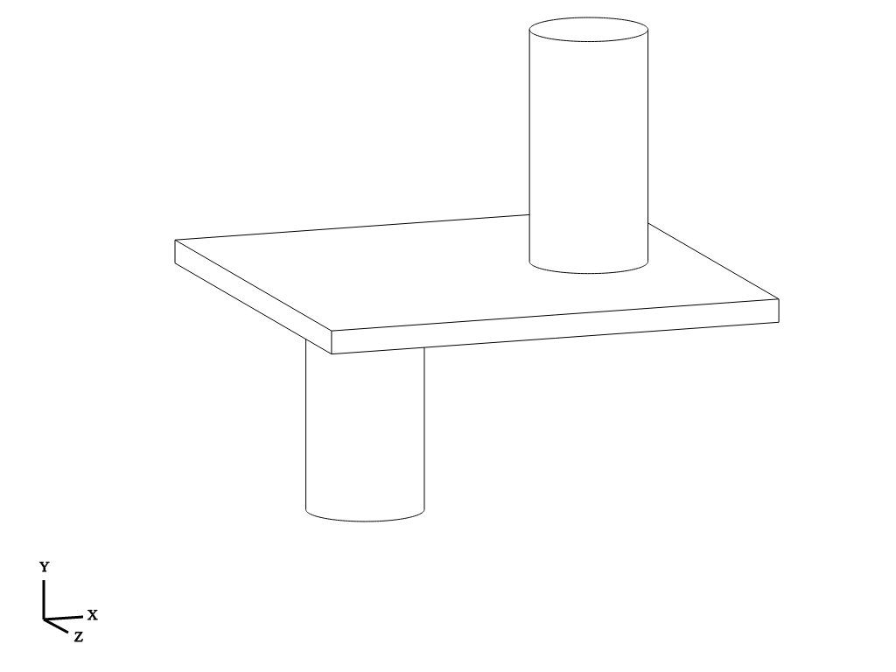
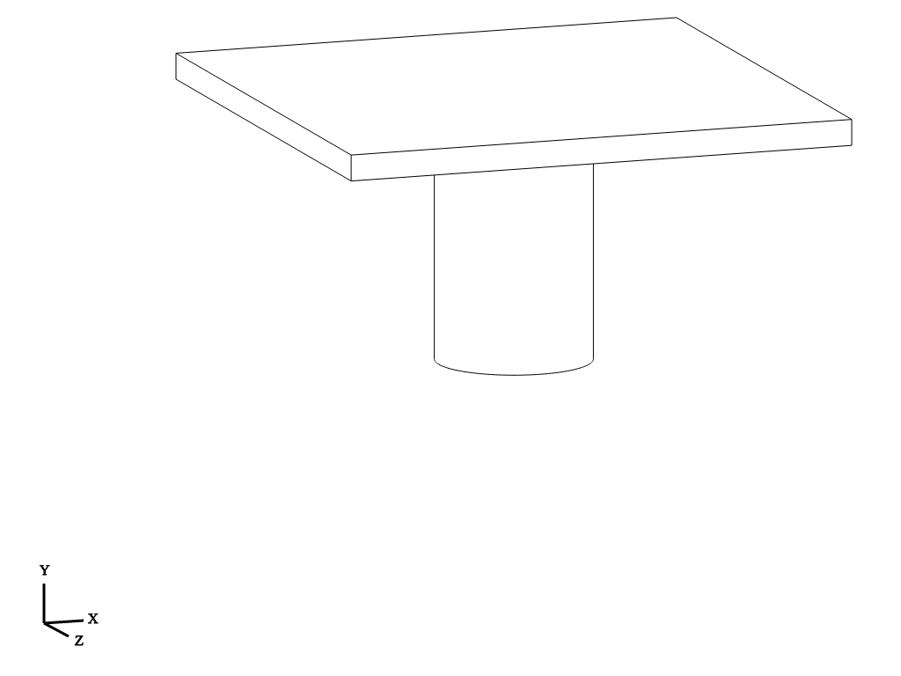
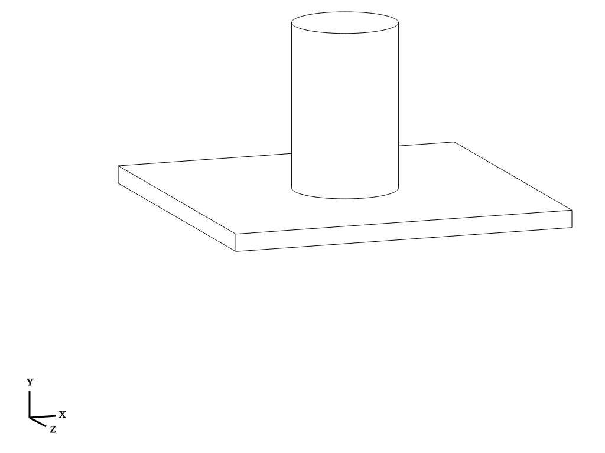

# Verification: `Workplane("XZ")` vs `Workplane("ZX")` and `Plane.named` Mechanics

## 1. How `cq.Plane` Computes Its Axes (`xDir`, `yDir`, `zDir`)

A `cq.Plane(origin, xDir, normal)` is constructed from an **origin**, a local X direction (**`xDir`**), and a plane normal (**`zDir`**). Inside `Plane._setPlaneDir(xDir)` and `Plane._calcTransforms()` (`cadquery/occ_impl/geom.py`), CadQuery constructs an OpenCASCADE right-handed coordinate system (`gp_Ax3`) and computes the local 2D Y axis (**`yDir`**) via the right-hand cross product:

```python
def _setPlaneDir(self, xDir):
    """Set the vectors parallel to the plane, i.e. xDir and yDir"""
    xDir = Vector(xDir)
    self.xDir = xDir.normalized()
    self.yDir = self.zDir.cross(self.xDir).normalized()
```

Because $\text{yDir} = \text{zDir} \times \text{xDir}$ (equivalently $\text{zDir} = \text{xDir} \times \text{yDir}$), **no right-handed plane in 3D space can simultaneously have `xDir = +X`, `yDir = +Z`, and `zDir (normal) = +Y`**. You can only pick two of the three:

| Definition | `xDir` (Local X) | `yDir` (`zDir × xDir`) | `zDir` (Normal / Extrude) | CadQuery Name |
|---|---|---|---|---|
| `Plane(origin, (1, 0, 0), (0, -1, 0))` | `+X` `(1, 0, 0)` | `+Z` `(0, 0, 1)` | **`-Y` `(0, -1, 0)`** | **`"XZ"`** ( or `"bottom"`) |
| `Plane(origin, (0, 0, 1), (0, 1, 0))` | **`+Z` `(0, 0, 1)`** | **`+X` `(1, 0, 0)`** | **`+Y` `(0, 1, 0)`** | **`"ZX"`** |
| `Plane(origin, (1, 0, 0), (0, 1, 0))` | `+X` `(1, 0, 0)` | **`-Z` `(0, 0, -1)`** | **`+Y` `(0, 1, 0)`** | **`"top"`** |

### Why Changing `"XZ"` to `Plane(origin, (1, 0, 0), (0, 1, 0))` Would Break `"XZ"`
In `cq.Plane.named()`, every two-letter plane name `"AB"` guarantees that the **first letter (`A`) is `+xDir`** and the **second letter (`B`) is `+yDir`**:
- If `"XZ"` were changed to `Plane(origin, (1, 0, 0), (0, 1, 0))`, then `yDir = zDir.cross(xDir) = (0, 1, 0) × (1, 0, 0) = (0, 0, -1)` (**`-Z`**). A 2D point `(10, 20)` would map to global `(10, 0, -20)` instead of `(10, 0, 20)`. (CadQuery actually provides `Plane(origin, (1, 0, 0), (0, 1, 0))` under the name `"top"`.)
- Because `"XZ"` must have `xDir = +X` and `yDir = +Z`, its normal is forced by the right-hand rule to be `zDir = -Y`.

### Direct Source-Code Extract (`inspect.getsource(cq.Plane.named)`)
```python
        =========== ======= ======= ======
        Name        xDir    yDir    zDir
        =========== ======= ======= ======
        XY          +x      +y      +z
        YZ          +y      +z      +x
        ZX          +z      +x      +y
        XZ          +x      +z      -y
        YX          +y      +x      -z
        ZY          +z      +y      -x
        front       +x      +y      +z
        back        -x      +y      -z
        left        +z      +y      -x
        right       -z      +y      +x
        top         +x      -z      +y
        bottom      +x      +z      -y
        =========== ======= ======= ======

        namedPlanes = {
            # origin, xDir, normal
            "XY": Plane(origin, (1, 0, 0), (0, 0, 1)),
            "YZ": Plane(origin, (0, 1, 0), (1, 0, 0)),
            "ZX": Plane(origin, (0, 0, 1), (0, 1, 0)),
            "XZ": Plane(origin, (1, 0, 0), (0, -1, 0)),
            "YX": Plane(origin, (0, 1, 0), (0, 0, -1)),
            "ZY": Plane(origin, (0, 0, 1), (-1, 0, 0)),
            ...
        }
```

---

## 2. Visual Proof (`./assets/`)

In each isometric render below, note the **`Y` axis arrow pointing UP** in the bottom-left coordinate triad:

### Combined Comparison (`examples/workplane_xz_vs_zx.py`)
Left cylinder (`X = -10`) extruded `+20` on `Workplane("XZ")` goes **DOWN (`-Y`)**; right cylinder (`X = +10`) extruded `+20` on `Workplane("ZX")` goes **UP (`+Y`)**:



### Single Cylinder on `Workplane("XZ")` (`.extrude(20)` -> `Y: 0 to -20`)


### Single Cylinder on `Workplane("ZX")` (`.extrude(20)` -> `Y: 0 to +20`)

